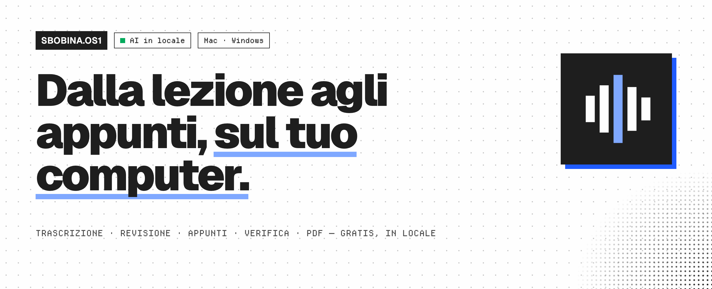
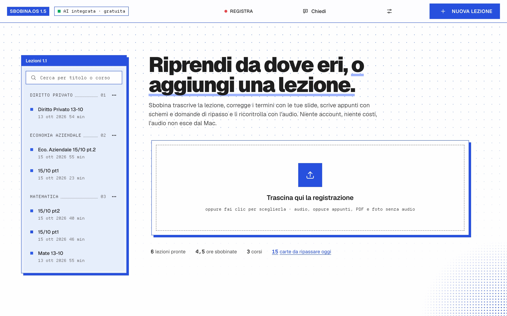
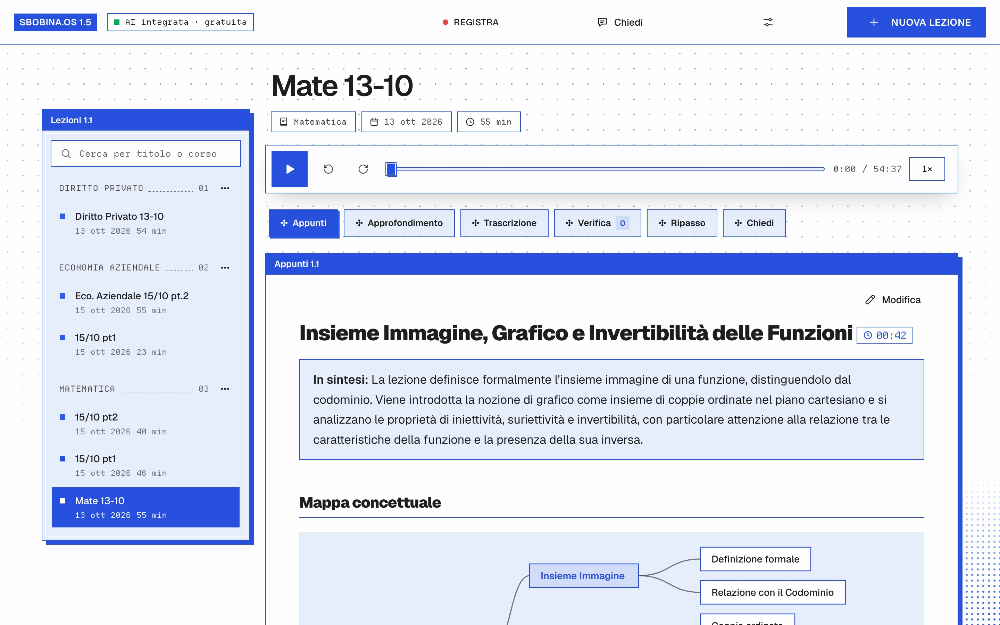
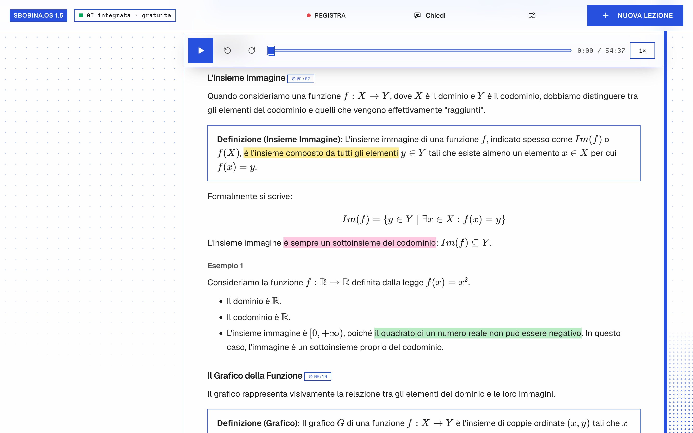
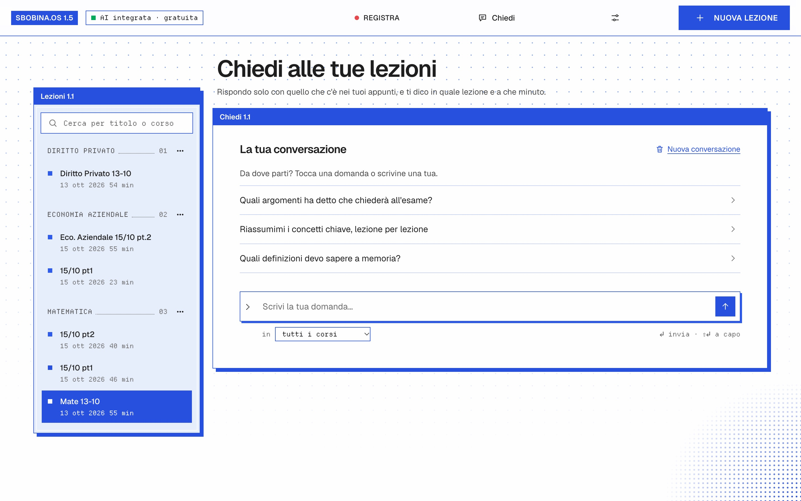
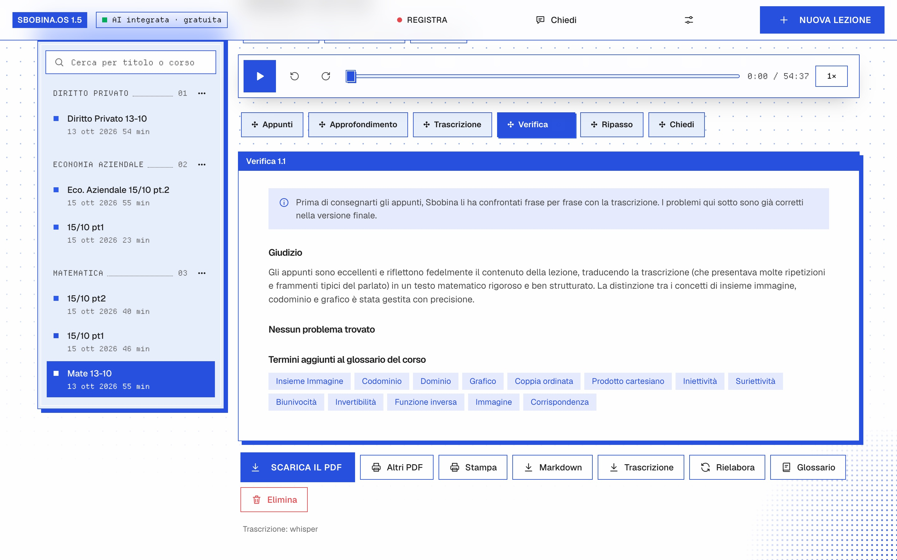
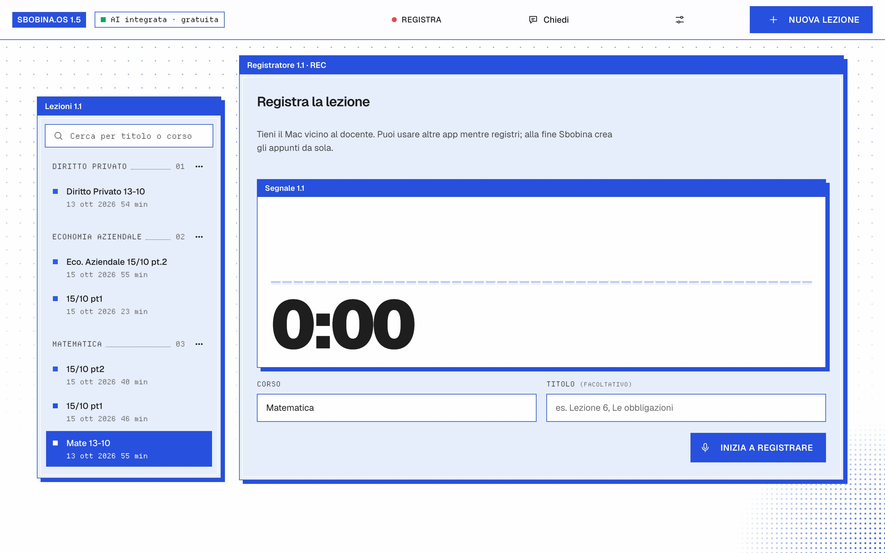
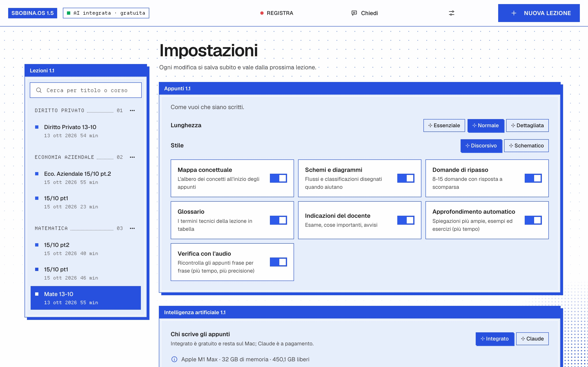
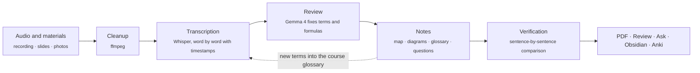
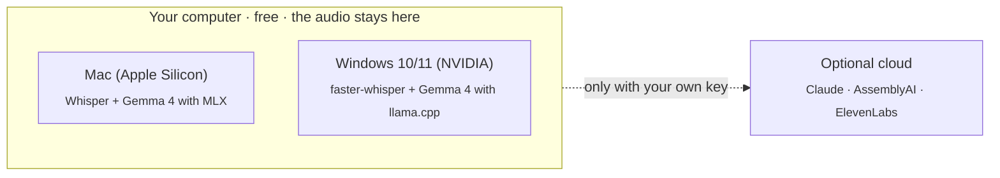

<p align="center"></p>

<p align="center"><code>SBOBINA.OS1</code> · <b>Mac</b> · <b>Windows</b> · free · local<br>
<a href="https://sbobina.vercel.app/en/"><b>Website</b></a> · <a href="README.md"><b>Italiano</b></a> · <a href="#installation">Install</a></p>

<p align="center">
  <a href="https://github.com/swumpyyy/sbobina/releases/latest/download/Sbobina-macOS.dmg"></a>
  <a href="https://github.com/swumpyyy/sbobina/releases/latest/download/Sbobina-Windows.zip"></a>
  <br><a href="https://github.com/swumpyyy/sbobina/releases"></a>
</p>

# Sbobina

**From lecture recordings to accurate study notes, with diagrams and concept maps.**

Record the lecture or upload the file you already have (voice memo, Teams, Zoom…): Sbobina writes
complete notes to prepare for your exam. Free, on your Mac or Windows PC, and the audio never leaves your computer.

<p align="center"></p>

<table>
<tr>
<td></td>
<td></td>
</tr>
<tr>
<td align="center"><sub>Notes with summary and concept map</sub></td>
<td align="center"><sub>Highlighter in four colors</sub></td>
</tr>
<tr>
<td></td>
<td></td>
</tr>
<tr>
<td align="center"><sub>Ask all your lectures at once</sub></td>
<td align="center"><sub>Notes checked against the transcript</sub></td>
</tr>
<tr>
<td></td>
<td></td>
</tr>
<tr>
<td align="center"><sub>Record from the microphone (or the widget)</sub></td>
<td align="center"><sub>Length, style and sections of the notes</sub></td>
</tr>
</table>

<p align="center"><br><sub>The recording widget, always on top</sub></p>

> **Italiano:** Sbobina trasforma le registrazioni delle lezioni in appunti completi, sul tuo Mac o PC Windows, gratis. Un tasto nell'app passa dall'italiano all'inglese. [README in italiano →](README.md)

## What you get for every lecture

- **Complete notes** with LaTeX formulas and the recording timestamp next to every heading (`⏱ 23:15`, one click and you hear it again).
- **Concept map**, **diagrams**, **glossary**, **review questions** and what the professor said "for the exam" (⭐).
- **Deep dive** beyond the lecture, expandable on request, and a **verification report**.
- **PDF** of the lecture or of the whole course, **Markdown**, **Obsidian** and **Anki** flashcards.
- **For studying**: flashcards (Leitner), quizzes, **Ask** across all lectures, highlighter, search, manual editing.
- **Record** from the microphone, also from the always-on-top widget; notes also **without audio** (PDF, photos).
- **Italian or English** with the button at the top: interface, notes, PDF and transcript.
- **Updates**: at launch Sbobina checks whether a new version is out and takes you to the download page.

## How it works

Every step removes one kind of error. Whatever the professor did not say ends up only in the
**Integration** boxes, and doubtful points stay marked `[uncertain]`.



What runs where:



With AssemblyAI or ElevenLabs enabled, the audio is transcribed twice independently and the review
picks the right version. The **course glossary grows on its own** and can be edited from the app.

## Installation

**The easiest way:** download the app from the [Releases](https://github.com/swumpyyy/sbobina/releases/latest) page.

| System | Download | How to install |
|---|---|---|
| macOS 12+ (Apple Silicon) | [Sbobina-macOS.dmg](https://github.com/swumpyyy/sbobina/releases/latest/download/Sbobina-macOS.dmg) | Open the .dmg and drag Sbobina into Applications. On first launch: right-click → **Open** (the app is not signed by Apple yet). |
| Windows 10/11 | [Sbobina-Windows.zip](https://github.com/swumpyyy/sbobina/releases/latest/download/Sbobina-Windows.zip) | Extract the zip and double-click **Installa Sbobina.bat**: it installs Python and the packages and puts Sbobina on the Desktop. |

Or from source code:

You need **Python 3.10 or newer** and **ffmpeg**. The free AI that writes the notes runs on your
computer, directly inside Sbobina (**Built-in** engine): **MLX** on a **Mac with Apple Silicon** (M1 or
newer), **llama.cpp** on a **Windows PC with an NVIDIA card** (see [Windows app](#windows-app)). On other
computers only Claude is left, which is paid. To create PDFs you also need Google Chrome (or Chromium or Edge).

```bash
# ffmpeg
brew install ffmpeg            # macOS
sudo apt install ffmpeg        # Ubuntu/Debian
winget install ffmpeg          # Windows

# Sbobina
git clone <this repository> sbobina && cd sbobina
python -m venv .venv
source .venv/bin/activate      # on Windows: .venv\Scripts\activate
pip install -e ".[locale,app]" # [locale] = free Whisper, [app] = native macOS app
cp .env.example .env
```

This way everything is **free and local**: no account, no key. In the `.env` file you can
add paid services if you want:

| Key | Used for | Where to get it |
|---|---|---|
| `ANTHROPIC_API_KEY` | optional: Claude instead of the local AI (with `SBOBINA_MODELLO=claude-opus-5-5`) | console.anthropic.com |
| `ASSEMBLYAI_API_KEY` | cloud transcription (recommended) | assemblyai.com |
| `ELEVENLABS_API_KEY` | second cloud transcription (maximum accuracy) | elevenlabs.io |

Without transcription keys Sbobina uses **Whisper locally**. It is free and the audio never leaves your computer, but without an
NVIDIA graphics card a 90-minute lecture can take more than an hour. On Macs with an Apple chip
(M1 and later) Sbobina uses **MLX Whisper** on the GPU with the large-v3-turbo model instead: much faster.

Check the setup with:

```bash
sbobina stato
```

## Usage

### Mac app

```bash
./scripts/crea_app_macos.sh
```

Creates **Sbobina.app** in `~/Applications` with its icon: open it from Launchpad or keep it in the Dock.
With `--dmg` it creates `dist/Sbobina.dmg` instead, a standalone app (Python, ffmpeg and the MLX engines included) to give
to anyone.

On first launch a guided setup asks for university, course and field of study, suggests the model
that fits the Mac's memory and downloads everything with a progress bar. From **Settings** (icon
at the top) you choose the length and style of the notes, the sections to include, the AI engine and model,
creativity and personal instructions, the PDF content, light/dark theme, color, text size,
and the notification and sound at the end of a lecture. During processing you can **stop** and then **resume** from the saved
point; the Dock shows how many lectures are being processed. PDFs, Markdown and transcripts are saved with the normal macOS *Save* dialog.
The app uses the `.venv` in this folder: if you move the folder, run the script again.
The error log is in `~/Library/Logs/Sbobina.log`.

### Windows app

Windows 10/11 with an NVIDIA card (tested on an RTX 5060 with 8 GB). Once, from the project folder:

```powershell
powershell -ExecutionPolicy Bypass -File scripts\installa_windows.ps1
```

It installs Python 3.12 (if missing), the packages and ffmpeg, and puts **Sbobina** on the Desktop. On first launch the app downloads:

- **llama.cpp** (`llama-server.exe`, CUDA 13 version: a recent NVIDIA driver is required) and the **Gemma 4 GGUF** model
  in place of MLX. With 8 GB of VRAM the recommended one is *Balanced* (E4B, 5 GB); larger models start anyway
  but put part of it in RAM and run slower.
- **Whisper** with faster-whisper on the GPU (CUDA DLLs via pip); if CUDA does not work, it transcribes on the CPU, which is slower.

On Windows, slide photos go through Windows OCR (the Italian language pack is required), notifications are
system toasts, and the microphone is the first DirectShow audio device. Data and models in `%LOCALAPPDATA%\Sbobina`,
log in `%LOCALAPPDATA%\Sbobina\sbobina.log` (and `llama-server.log` for the AI engine).

### Web app

```bash
sbobina server
```

The browser opens at `http://localhost:8000`. Click **+ New lecture** and upload:

- **the recording** (you can select several files: each becomes a lecture);
- **the course** (groups the lectures and the glossary);
- optional but very useful: **slides/handouts** as PDF, **photos of the board**, **names and difficult
  terms** (e.g. the professor's name), **directions** (e.g. "focus on the proofs").

Follow the progress in real time. You can close the browser: processing continues as long as the
server is running, and if you turn it off midway it resumes from the last completed step.

### All recordings at once, from the terminal

```bash
# a whole folder of recordings from the same course
sbobina elabora ~/Registrazioni/Analisi1/ --corso "Analisi 1" --materiali slide/*.pdf

# a single lecture
sbobina elabora lezione07.m4a --corso "Fisica 1" --titolo "Lecture 7 - Dynamics" \
    --termini "Newton, D'Alembert, momentum"

sbobina elenco                      # all lectures with their status
sbobina rielabora <id> --da appunti # rewrites the notes (e.g. after fixing the glossary)
```

The notes end up in `dati/lezioni/<id>/appunti.md` and `appunti.html` (open it and use
"Print → Save as PDF").

## Costs

- **With the default settings Sbobina is free**: Whisper and Gemma (in MLX, inside Sbobina) run on your
  computer. The price is time: on a Mac with an M chip a one-hour lecture takes roughly
  half an hour to an hour between transcription and writing.
- **Claude** (optional): with Claude Opus 5.5 a 90-minute lecture costs roughly **$2-4**.
  The app shows the estimated cost of every lecture.
- **Transcription**: AssemblyAI and ElevenLabs are billed per hour of audio; check their price lists.
  ElevenLabs applies a surcharge when glossary terms are passed. Local Whisper is
  free.

## Recording tips (accuracy starts here)

- Sit in the front rows or put your phone near the desk, with the microphone pointing at the professor.
- Airplane mode while recording: no vibrations or notifications in the audio.
- One file per lecture. If the recording is interrupted, upload the pieces as separate lectures.
- Upload the lecture slides: it is the most effective way to get correct terms, formulas and names.

## Known issues

- **Mac app not signed by Apple.** On first launch macOS blocks it: right-click → **Open**. It needs an Apple Developer ID (paid), not obtained yet.
- **Windows tested on one PC only** (Windows 11, RTX 5060 8 GB): a full lecture works, a clean install from the zip has not been fully tested yet.
- **Recording from the microphone** requires the Mac's permission (System Settings → Privacy & Security → Microphone). Without it, the app says so; a long recording from the app has not yet been thoroughly tested.
- **Slow or interrupted model downloads.** On some networks Hugging Face stalls or closes the connection: Sbobina restarts on its own after 60 seconds without data. The largest model weighs about 15 GB, so the first download can take hours.
- **Flashcards and quizzes with the built-in AI.** Sometimes Gemma writes broken JSON: Sbobina repairs it and retries once, but "try again" may appear. Just regenerate.

Found something else? Open an [issue](https://github.com/swumpyyy/sbobina/issues).

## Privacy

The audio stays on your computer, except when you use the cloud transcription services (AssemblyAI,
ElevenLabs), to which the audio is sent. With the local AI (default) transcription and
materials also stay on the computer; only if you choose Claude are they sent to Anthropic. All results are saved locally in the `dati/` folder.
The server listens only on `localhost`.

## Project structure

```
sbobina/
  audio.py              audio preparation with ffmpeg
  trascrizione/         engines: AssemblyAI, ElevenLabs, local Whisper
  materiali.py          PDF slides, images, texts → content for the AI
  prompt.py             instructions for the AI (review, notes, verification, correction, deep dive)
  llm.py                the writing model: Built-in (MLX) or Claude; live view and download
  impostazioni.py       the student's choices (impostazioni.json)
  sistema.py            the Mac (chip, memory) and the suitable models
  studio.py             search, quizzes, flashcards and Leitner review, questions to the lecture, Anki/Obsidian
  registrazione.py      recording from the microphone with ffmpeg
  pipeline.py           the processing stages, resuming from saved points
  archivio.py           lectures and courses saved as JSON files
  server.py, static/    web app
  cli.py                terminal commands
tests/                  automated tests (pytest)
```

For every lecture, `dati/lezioni/<id>/` contains `originale.*`, `ascolto.mp3`,
`trascrizione_<motore>.json` (raw transcript with the timing of every word), `trascrizione.md`
(reviewed), `appunti_bozza.md`, `verifica.json`, `appunti.md` and `appunti.html`.

## Development

```bash
pip install -e ".[dev,locale]"
pytest
```

The tests do not use external services: the AI model and the transcription engines are replaced by fake
versions, while ffmpeg, the Anthropic SDK (with a simulated HTTP transport) and the web app are real.
