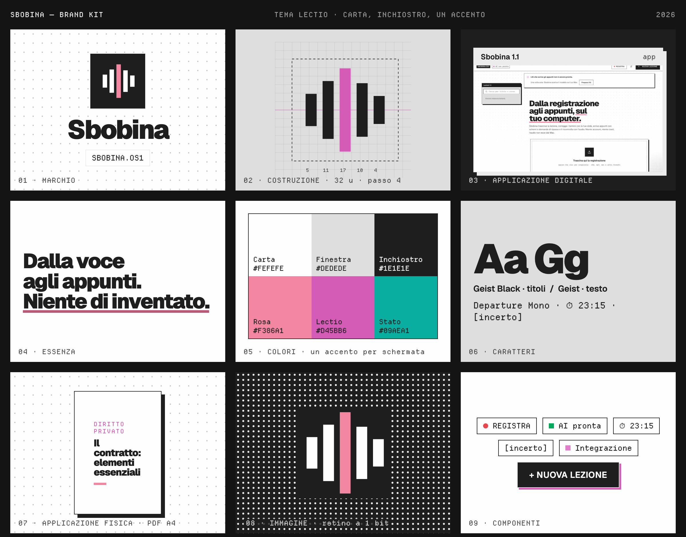

<p align="center"></p>

<p align="center"><code>SBOBINA.OS1</code> · <b>Mac</b> · <b>Windows</b> · gratis · in locale<br>
<a href="docs/index.html"><b>Pagina del progetto</b></a> · <a href="docs/brandkit.html">Brand kit</a> · <a href="#installazione">Installa</a></p>

# Sbobina

**Dalle registrazioni delle lezioni ad appunti di studio accurati, con schemi e mappe concettuali.**

Sbobina prende gli audio che hai già (note vocali del telefono, registratore, file di Teams/Zoom…)
oppure registra la lezione dal microfono del computer, e li trasforma in appunti completi, pensati per
studiare e preparare l'esame.
L'obiettivo è l'accuratezza: ogni passaggio è progettato per ridurre gli errori di trascrizione e
per non far inventare nulla agli appunti.

<p align="center"></p>

## Cosa ottieni per ogni lezione

- **Appunti completi in Markdown**: definizioni, teoremi con ipotesi e tesi, dimostrazioni ed
  esercizi con tutti i passaggi, esempi, formule in LaTeX, tabelle di confronto.
- **Mappa concettuale** interattiva della lezione e **schemi** (flussi, processi, classificazioni).
- **Indicazioni del docente**: tutto ciò che è stato segnalato come importante o "da esame" (⭐).
- **Glossario** dei termini tecnici e **domande di ripasso** con risposta nascosta.
- **Tempi cliccabili** `⏱ 23:15`: un clic e riascolti quel punto della registrazione.
- **Trascrizione revisionata** completa e un **rapporto di verifica** con i problemi trovati e corretti.
- **Approfondimento**: non un riassunto ma una spiegazione più ampia dell'argomento, con esempi,
  esercizi svolti e domande d'esame. Puoi chiedere di **approfondire ancora** un punto: l'AI aggiunge
  una nuova sezione.
- **PDF della lezione** con copertina (corso, data, durata): solo appunti, con l'approfondimento o con
  la trascrizione. **PDF di tutto il corso** con indice. Esportazione in **Markdown** e in una cartella
  per **Obsidian** (una nota per lezione, con collegamenti).
- **Per studiare**: **flashcard** con ripasso a scatole (Leitner) ed esportazione per **Anki**, **quiz** a
  scelta multipla con spiegazioni, **Chiedi alla lezione** (risposte che citano il minuto), **ricerca**
  nel testo di tutte le lezioni, **modifica a mano** degli appunti.
- **Trascrizione che segue l'audio**: il paragrafo in ascolto si illumina, un clic e riascolti da lì;
  velocità 1×–2×.

## Perché è accurato

Un'app che "registra e scrive" fa una trascrizione e un riassunto. Sbobina fa sei passaggi:

1. **Audio ripulito**: ffmpeg converte qualsiasi formato, toglie i rimbombi e uniforma il volume
   (utile quando il docente si allontana dal microfono).
2. **Termini dalle slide**: se carichi slide o dispense, l'AI ne estrae termini tecnici, nomi e
   sigle e li passa al riconoscimento vocale, che così li scrive giusti.
3. **Trascrizione con uno o due motori**: AssemblyAI (Universal-3.5 Pro) ed ElevenLabs (Scribe v2)
   sono tra i più accurati sull'italiano; Whisper large-v3 funziona in locale e gratis. Con due
   motori attivi, l'audio viene trascritto due volte in modo indipendente.
4. **Revisione della trascrizione**: l'AI la corregge blocco per blocco (termini, nomi, formule
   dettate a voce, punteggiatura) usando glossario e materiali. Quando i due motori non sono
   d'accordo sceglie la versione giusta. Non riassume e non aggiunge nulla: i punti dubbi restano
   segnati come `[incerto]`.
5. **Appunti**: scritti dalla trascrizione revisionata e dalle slide. Ciò che non è stato detto a
   lezione può comparire solo in un riquadro **Integrazione**, ben distinto.
6. **Verifica e correzione**: una seconda lettura confronta gli appunti con la trascrizione frase per
   frase (affermazioni non supportate, formule o ipotesi sbagliate, contenuti omessi, schemi errati)
   e una terza applica le correzioni.
7. **Approfondimento**: spiega l'argomento oltre la lezione. Ciò che non è stato detto a lezione
   sta nei riquadri **Integrazione**; i dettagli incerti sono segnati come `[da verificare]`.

In più il **glossario del corso cresce da solo**: i termini di ogni lezione vengono usati per
riconoscere meglio le lezioni successive dello stesso corso. Puoi modificarlo dall'app (ad esempio
aggiungendo il nome del docente).

## Installazione

Ti servono **Python 3.10 o più recente** e **ffmpeg**. L'AI gratuita che scrive gli appunti gira sul tuo
computer, direttamente dentro Sbobina (motore **Integrato**): **MLX** su un **Mac con Apple Silicon** (M1 o più
recente), **llama.cpp** su un **PC Windows con scheda NVIDIA** (vedi [App per Windows](#app-per-windows)). Su altri
computer resta solo Claude, a pagamento. Per creare i PDF serve anche Google Chrome (o Chromium o Edge).

```bash
# ffmpeg
brew install ffmpeg            # macOS
sudo apt install ffmpeg        # Ubuntu/Debian
winget install ffmpeg          # Windows

# Sbobina
git clone <questo repository> sbobina && cd sbobina
python -m venv .venv
source .venv/bin/activate      # su Windows: .venv\Scripts\activate
pip install -e ".[locale,app]" # [locale] = Whisper gratuito, [app] = app nativa per macOS
cp .env.example .env
```

Così tutto è **gratuito e in locale**: nessun account, nessuna chiave. Nel file `.env` puoi
aggiungere, se vuoi, servizi a pagamento:

| Chiave | Serve per | Dove si ottiene |
|---|---|---|
| `ANTHROPIC_API_KEY` | facoltativa: Claude al posto dell'AI locale (con `SBOBINA_MODELLO=claude-opus-5-5`) | console.anthropic.com |
| `ASSEMBLYAI_API_KEY` | trascrizione cloud (consigliata) | assemblyai.com |
| `ELEVENLABS_API_KEY` | seconda trascrizione cloud (massima accuratezza) | elevenlabs.io |

Senza chiavi di trascrizione Sbobina usa **Whisper in locale**. È gratuito e l'audio non lascia il tuo computer, ma senza una
scheda video NVIDIA una lezione di 90 minuti può richiedere più di un'ora. Sui Mac con chip Apple
(M1 e successivi) Sbobina usa invece **MLX Whisper** sulla GPU con il modello large-v3-turbo: molto più veloce.

Controlla la configurazione con:

```bash
sbobina stato
```

## Uso

### App per Mac

```bash
./scripts/crea_app_macos.sh
```

Crea **Sbobina.app** in `~/Applications` con la sua icona: aprila dal Launchpad o tienila nel Dock.
Con `--dmg` crea invece `dist/Sbobina.dmg`, un'app autonoma (Python, ffmpeg e i motori MLX inclusi) da dare
a chiunque.

Al primo avvio una procedura guidata chiede università, corso e area di studio, propone il modello
adatto alla memoria del Mac e scarica tutto con una barra di avanzamento. Dalle **Impostazioni** (icona
in alto) scegli lunghezza e stile degli appunti, le sezioni da includere, motore e modello dell'AI,
creatività e istruzioni personali, il contenuto del PDF, tema chiaro/scuro, colore, dimensione del testo,
notifica e suono a fine lezione. Durante l'elaborazione puoi **fermare** e poi **riprendere** dal punto
salvato; il Dock mostra quante lezioni sono in lavorazione. PDF, Markdown e trascrizioni si salvano con la normale finestra *Salva* di macOS.
L'app usa il `.venv` di questa cartella: se sposti la cartella, rilancia lo script.
Il registro degli errori è in `~/Library/Logs/Sbobina.log`.

### App per Windows

Windows 10/11 con una scheda NVIDIA (pensato per una RTX serie 50 con 8 GB; non ancora provato su un PC vero). Una volta sola, dalla cartella del progetto:

```powershell
powershell -ExecutionPolicy Bypass -File scripts\installa_windows.ps1
```

Installa Python 3.12 (se manca), i pacchetti e ffmpeg, e mette **Sbobina** sul Desktop. Al primo avvio l'app scarica:

- **llama.cpp** (`llama-server.exe`, versione CUDA 13: serve un driver NVIDIA recente) e il modello **Gemma 4 in GGUF**
  al posto di MLX. Con 8 GB di VRAM il consigliato è *Equilibrato* (E4B, 5 GB); i modelli più grandi partono lo stesso
  ma mettono una parte in RAM e vanno più lenti.
- **Whisper** con faster-whisper sulla GPU (DLL CUDA via pip); se CUDA non va, trascrive sul processore, più lento.

Su Windows le foto delle slide passano dall'OCR di Windows (serve il pacchetto lingua italiano), le notifiche sono
toast di sistema, il microfono è il primo dispositivo audio di DirectShow. Dati e modelli in `%LOCALAPPDATA%\Sbobina`,
registro in `%LOCALAPPDATA%\Sbobina\sbobina.log` (e `llama-server.log` per il motore AI).

### App web

```bash
sbobina server
```

Si apre il browser su `http://localhost:8000`. Clicca **+ Nuova lezione** e carica:

- **la registrazione** (puoi selezionare più file: ognuno diventa una lezione);
- **il corso** (raggruppa le lezioni e il glossario);
- facoltativi ma molto utili: **slide/dispense** in PDF, **foto della lavagna**, **nomi e termini
  difficili** (es. il nome del docente), **indicazioni** (es. "insistere sulle dimostrazioni").

Segui l'avanzamento in tempo reale. Puoi chiudere il browser: l'elaborazione continua finché il
server è acceso, e se lo spegni a metà riprende dall'ultimo passo completato.

### Tutte le registrazioni insieme, da terminale

```bash
# una cartella intera di registrazioni dello stesso corso
sbobina elabora ~/Registrazioni/Analisi1/ --corso "Analisi 1" --materiali slide/*.pdf

# una singola lezione
sbobina elabora lezione07.m4a --corso "Fisica 1" --titolo "Lezione 7 – Dinamica" \
    --termini "Newton, D'Alembert, quantità di moto"

sbobina elenco                      # tutte le lezioni con il loro stato
sbobina rielabora <id> --da appunti # riscrive gli appunti (es. dopo aver corretto il glossario)
```

Gli appunti finiscono in `dati/lezioni/<id>/appunti.md` e `appunti.html` (aprila e usa
"Stampa → Salva come PDF").

## Costi

- **Con le impostazioni predefinite Sbobina è gratuito**: Whisper e Gemma (in MLX, dentro Sbobina) girano sul tuo
  computer. Il prezzo è il tempo: su un Mac con chip M una lezione di un'ora richiede indicativamente
  da mezz'ora a un'ora tra trascrizione e scrittura.
- **Claude** (facoltativo): con Claude Opus 5.5 una lezione di 90 minuti costa indicativamente **2-4 $**.
  L'app mostra il costo stimato di ogni lezione.
- **Trascrizione**: AssemblyAI ed ElevenLabs si pagano a ore di audio; controlla i loro listini.
  ElevenLabs applica un supplemento quando si passano i termini del glossario. Whisper locale è
  gratuito.

## Consigli per registrare (l'accuratezza parte da qui)

- Siediti nelle prime file o appoggia il telefono vicino alla cattedra, con il microfono verso il docente.
- Modalità aereo durante la registrazione: niente vibrazioni o notifiche nell'audio.
- Un file per lezione. Se la registrazione si interrompe, carica i pezzi come lezioni separate.
- Carica le slide della lezione: è il modo più efficace per avere termini, formule e nomi corretti.

## Privacy

L'audio resta sul tuo computer, salvo quando usi i servizi cloud di trascrizione (AssemblyAI,
ElevenLabs), a cui viene inviato l'audio. Con l'AI locale (predefinita) anche trascrizione e
materiali restano sul computer; solo se scegli Claude vengono inviati ad Anthropic. Tutti i risultati sono salvati in locale nella cartella `dati/`.
Il server ascolta solo su `localhost`.

## Brand kit

Tema **Lectio**: carta e inchiostro a 1 bit, finestre con la barra del titolo nera, griglia a puntini, un solo
accento rosa. Il marchio è la voce che diventa testo: cinque barre d'onda, la centrale in rosa.

<p align="center"></p>

## Struttura del progetto

```
sbobina/
  audio.py              preparazione dell'audio con ffmpeg
  trascrizione/         motori: AssemblyAI, ElevenLabs, Whisper locale
  materiali.py          slide PDF, immagini, testi → contenuti per l'AI
  prompt.py             istruzioni per l'AI (revisione, appunti, verifica, correzione, approfondimento)
  llm.py                modello che scrive: Integrato (MLX) o Claude; vista in diretta e download
  impostazioni.py       le scelte dello studente (impostazioni.json)
  sistema.py            il Mac (chip, memoria) e i modelli adatti
  studio.py             ricerca, quiz, flashcard e ripasso Leitner, domande alla lezione, Anki/Obsidian
  registrazione.py      registrazione dal microfono con ffmpeg
  pipeline.py           le fasi dell'elaborazione, con ripresa dai punti salvati
  archivio.py           lezioni e corsi salvati come file JSON
  server.py, static/    app web
  cli.py                comandi da terminale
tests/                  test automatici (pytest)
```

Per ogni lezione, `dati/lezioni/<id>/` contiene `originale.*`, `ascolto.mp3`,
`trascrizione_<motore>.json` (trascrizione grezza con i tempi di ogni parola), `trascrizione.md`
(revisionata), `appunti_bozza.md`, `verifica.json`, `appunti.md` e `appunti.html`.

## Sviluppo

```bash
pip install -e ".[dev,locale]"
pytest
```

I test non usano servizi esterni: il modello AI e i motori di trascrizione sono sostituiti da versioni
finte, mentre ffmpeg, l'SDK di Anthropic (con un trasporto HTTP simulato) e l'app web sono reali.
