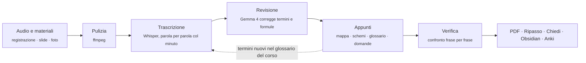
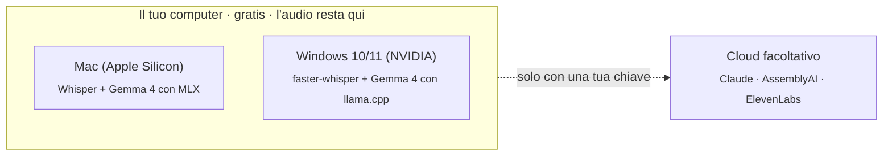

<p align="center"></p>

<p align="center"><code>SBOBINA.OS1</code> · <b>Mac</b> · <b>Windows</b> · gratis · in locale<br>
<a href="https://sbobina.vercel.app"><b>Sito</b></a> · <a href="README.en.md"><b>English</b></a> · <a href="#installazione">Installa</a></p>

<p align="center">
  <a href="https://github.com/swumpyyy/sbobina/releases/latest/download/Sbobina-macOS.dmg"></a>
  <a href="https://github.com/swumpyyy/sbobina/releases/latest/download/Sbobina-Windows.zip"></a>
  <br><a href="https://github.com/swumpyyy/sbobina/releases"></a>
</p>

# Sbobina

**Dalle registrazioni delle lezioni ad appunti di studio accurati, con schemi e mappe concettuali.**

Registra la lezione o carica il file che hai già (nota vocale, Teams, Zoom…): Sbobina scrive appunti
completi per preparare l'esame. Gratis, sul tuo Mac o PC Windows, e l'audio non esce dal computer.

<p align="center"></p>

<table>
<tr>
<td></td>
<td></td>
</tr>
<tr>
<td align="center"><sub>Appunti con sintesi e mappa concettuale</sub></td>
<td align="center"><sub>Evidenziatore in quattro colori</sub></td>
</tr>
<tr>
<td></td>
<td></td>
</tr>
<tr>
<td align="center"><sub>Chiedi a tutte le tue lezioni insieme</sub></td>
<td align="center"><sub>Verifica degli appunti contro la trascrizione</sub></td>
</tr>
<tr>
<td></td>
<td></td>
</tr>
<tr>
<td align="center"><sub>Registra dal microfono (o dal widget)</sub></td>
<td align="center"><sub>Lunghezza, stile e sezioni degli appunti</sub></td>
</tr>
</table>

<p align="center"><br><sub>Il widget di registrazione, sempre in primo piano</sub></p>

> **English:** Sbobina turns lecture recordings into complete study notes, fully on your own Mac or Windows PC, for free. One button in the app switches between Italian and English. [README in English →](README.en.md)

## Cosa ottieni per ogni lezione

- **Appunti completi** con formule in LaTeX e il minuto della registrazione accanto a ogni titolo (`⏱ 23:15`, un clic e riascolti).
- **Mappa concettuale**, **schemi**, **glossario**, **domande di ripasso** e ciò che il docente ha detto "da esame" (⭐).
- **Approfondimento** oltre la lezione, ampliabile su richiesta, e **rapporto di verifica**.
- **PDF** della lezione o di tutto il corso, **Markdown**, **Obsidian** e flashcard per **Anki**.
- **Per studiare**: flashcard (Leitner), quiz, **Chiedi** a tutte le lezioni, evidenziatore, ricerca, modifica a mano.
- **Registra** dal microfono, anche dal widget sempre in primo piano; appunti anche **senza audio** (PDF, foto).
- **Italiano o inglese** con il tasto in alto: interfaccia, appunti, PDF e trascrizione.
- **Aggiornamenti**: all'avvio Sbobina controlla se c'è una versione nuova e ti porta alla pagina di download.

## Come funziona

Ogni passaggio toglie un tipo di errore. Ciò che il docente non ha detto finisce solo nei riquadri
**Integrazione**, i punti dubbi restano segnati `[incerto]`.



Cosa gira dove:



Con AssemblyAI o ElevenLabs attivi l'audio viene trascritto due volte in modo indipendente e la revisione
sceglie la versione giusta. Il **glossario del corso cresce da solo** e si può modificare dall'app.

## Installazione

**Il modo più semplice:** scarica l'app dalla pagina [Releases](https://github.com/swumpyyy/sbobina/releases/latest).

| Sistema | Download | Come si installa |
|---|---|---|
| macOS 12+ (Apple Silicon) | [Sbobina-macOS.dmg](https://github.com/swumpyyy/sbobina/releases/latest/download/Sbobina-macOS.dmg) | Apri il .dmg e trascina Sbobina in Applicazioni. Al primo avvio: tasto destro → **Apri** (l'app non è ancora firmata da Apple). |
| Windows 10/11 | [Sbobina-Windows.zip](https://github.com/swumpyyy/sbobina/releases/latest/download/Sbobina-Windows.zip) | Estrai lo zip e fai doppio clic su **Installa Sbobina.bat**: installa Python e i pacchetti e mette Sbobina sul Desktop. Stessa versione del Mac. |

Oppure dal codice sorgente:

Ti servono **Python 3.10 o più recente** e **ffmpeg**. L'AI gratuita che scrive gli appunti gira sul tuo
computer, direttamente dentro Sbobina (motore **Integrato**): **MLX** su un **Mac con Apple Silicon** (M1 o più
recente), **llama.cpp** su un **PC Windows con scheda NVIDIA** (vedi [App per Windows](#app-per-windows)). Su altri
computer resta solo Claude, a pagamento. Per creare i PDF serve anche Google Chrome (o Chromium o Edge).

```bash
# ffmpeg
brew install ffmpeg            # macOS
sudo apt install ffmpeg        # Ubuntu/Debian
winget install ffmpeg          # Windows

# Sbobina
git clone <questo repository> sbobina && cd sbobina
python -m venv .venv
source .venv/bin/activate      # su Windows: .venv\Scripts\activate
pip install -e ".[locale,app]" # [locale] = Whisper gratuito, [app] = app nativa per macOS
cp .env.example .env
```

Così tutto è **gratuito e in locale**: nessun account, nessuna chiave. Nel file `.env` puoi
aggiungere, se vuoi, servizi a pagamento:

| Chiave | Serve per | Dove si ottiene |
|---|---|---|
| `ANTHROPIC_API_KEY` | facoltativa: Claude al posto dell'AI locale (con `SBOBINA_MODELLO=claude-opus-5-5`) | console.anthropic.com |
| `ASSEMBLYAI_API_KEY` | trascrizione cloud (consigliata) | assemblyai.com |
| `ELEVENLABS_API_KEY` | seconda trascrizione cloud (massima accuratezza) | elevenlabs.io |

Senza chiavi di trascrizione Sbobina usa **Whisper in locale**. È gratuito e l'audio non lascia il tuo computer, ma senza una
scheda video NVIDIA una lezione di 90 minuti può richiedere più di un'ora. Sui Mac con chip Apple
(M1 e successivi) Sbobina usa invece **MLX Whisper** sulla GPU con il modello large-v3-turbo: molto più veloce.

Controlla la configurazione con:

```bash
sbobina stato
```

## Uso

### App per Mac

```bash
./scripts/crea_app_macos.sh
```

Crea **Sbobina.app** in `~/Applications` con la sua icona: aprila dal Launchpad o tienila nel Dock.
Con `--dmg` crea invece `dist/Sbobina.dmg`, un'app autonoma (Python, ffmpeg e i motori MLX inclusi) da dare
a chiunque.

Al primo avvio una procedura guidata chiede università, corso e area di studio, propone il modello
adatto alla memoria del Mac e scarica tutto con una barra di avanzamento. Dalle **Impostazioni** (icona
in alto) scegli lunghezza e stile degli appunti, le sezioni da includere, motore e modello dell'AI,
creatività e istruzioni personali, il contenuto del PDF, tema chiaro/scuro, colore, dimensione del testo,
notifica e suono a fine lezione. Durante l'elaborazione puoi **fermare** e poi **riprendere** dal punto
salvato; il Dock mostra quante lezioni sono in lavorazione. PDF, Markdown e trascrizioni si salvano con la normale finestra *Salva* di macOS.
L'app usa il `.venv` di questa cartella: se sposti la cartella, rilancia lo script.
Il registro degli errori è in `~/Library/Logs/Sbobina.log`.

### App per Windows

Windows 10/11 con una scheda NVIDIA (provato su una RTX 5060 con 8 GB). Una volta sola, dalla cartella del progetto:

```powershell
powershell -ExecutionPolicy Bypass -File scripts\installa_windows.ps1
```

Installa Python 3.12 (se manca), i pacchetti e ffmpeg, e mette **Sbobina** sul Desktop. Al primo avvio l'app scarica:

- **llama.cpp** (`llama-server.exe`, versione CUDA 13: serve un driver NVIDIA recente) e il modello **Gemma 4 in GGUF**
  al posto di MLX. Con 8 GB di VRAM il consigliato è *Equilibrato* (E4B, 5 GB); i modelli più grandi partono lo stesso
  ma mettono una parte in RAM e vanno più lenti.
- **Whisper** con faster-whisper sulla GPU (DLL CUDA via pip); se CUDA non va, trascrive sul processore, più lento.

Su Windows le foto delle slide passano dall'OCR di Windows (serve il pacchetto lingua italiano), le notifiche sono
toast di sistema, il microfono è il primo dispositivo audio di DirectShow, il widget di registrazione si riduce
nell'area di notifica (accanto all'orologio) invece che nella barra dei menu. Dati e modelli in `%LOCALAPPDATA%\Sbobina`,
registro in `%LOCALAPPDATA%\Sbobina\sbobina.log` (e `llama-server.log` per il motore AI).

### App web

```bash
sbobina server
```

Si apre il browser su `http://localhost:8000`. Clicca **+ Nuova lezione** e carica:

- **la registrazione** (puoi selezionare più file: ognuno diventa una lezione);
- **il corso** (raggruppa le lezioni e il glossario);
- facoltativi ma molto utili: **slide/dispense** in PDF, **foto della lavagna**, **nomi e termini
  difficili** (es. il nome del docente), **indicazioni** (es. "insistere sulle dimostrazioni").

Segui l'avanzamento in tempo reale. Puoi chiudere il browser: l'elaborazione continua finché il
server è acceso, e se lo spegni a metà riprende dall'ultimo passo completato.

### Tutte le registrazioni insieme, da terminale

```bash
# una cartella intera di registrazioni dello stesso corso
sbobina elabora ~/Registrazioni/Analisi1/ --corso "Analisi 1" --materiali slide/*.pdf

# una singola lezione
sbobina elabora lezione07.m4a --corso "Fisica 1" --titolo "Lezione 7 – Dinamica" \
    --termini "Newton, D'Alembert, quantità di moto"

sbobina elenco                      # tutte le lezioni con il loro stato
sbobina rielabora <id> --da appunti # riscrive gli appunti (es. dopo aver corretto il glossario)
```

Gli appunti finiscono in `dati/lezioni/<id>/appunti.md` e `appunti.html` (aprila e usa
"Stampa → Salva come PDF").

## Costi

- **Con le impostazioni predefinite Sbobina è gratuito**: Whisper e Gemma (in MLX, dentro Sbobina) girano sul tuo
  computer. Il prezzo è il tempo: su un Mac con chip M una lezione di un'ora richiede indicativamente
  da mezz'ora a un'ora tra trascrizione e scrittura.
- **Claude** (facoltativo): con Claude Opus 5.5 una lezione di 90 minuti costa indicativamente **2-4 $**.
  L'app mostra il costo stimato di ogni lezione.
- **Trascrizione**: AssemblyAI ed ElevenLabs si pagano a ore di audio; controlla i loro listini.
  ElevenLabs applica un supplemento quando si passano i termini del glossario. Whisper locale è
  gratuito.

## Consigli per registrare (l'accuratezza parte da qui)

- Siediti nelle prime file o appoggia il telefono vicino alla cattedra, con il microfono verso il docente.
- Modalità aereo durante la registrazione: niente vibrazioni o notifiche nell'audio.
- Un file per lezione. Se la registrazione si interrompe, carica i pezzi come lezioni separate.
- Carica le slide della lezione: è il modo più efficace per avere termini, formule e nomi corretti.

## Problemi noti

- **App per Mac non firmata da Apple.** Al primo avvio macOS la blocca: tasto destro → **Apri**. Serve un Apple Developer ID (a pagamento), non ancora preso.
- **Windows provato su un solo PC** (Windows 11, RTX 5060 8 GB): una lezione completa funziona, l'installazione pulita dallo zip non è ancora stata provata fino in fondo.
- **Registrare dal microfono** richiede il permesso del Mac (Impostazioni di Sistema → Privacy e sicurezza → Microfono). Senza, l'app lo dice; una registrazione lunga dall'app non è ancora stata provata a fondo.
- **Download dei modelli lenti o interrotti.** Da alcune reti Hugging Face si blocca o chiude la connessione: Sbobina riparte da sola dopo 60 secondi senza dati. Il modello più grande pesa circa 15 GB, quindi il primo download può richiedere ore.
- **Flashcard e quiz con l'AI integrata.** A volte Gemma scrive un JSON rotto: Sbobina lo ripara e riprova una volta, ma può comparire "riprova". Basta rigenerare.

Hai trovato altro? Apri una [segnalazione](https://github.com/swumpyyy/sbobina/issues).

## Privacy

L'audio resta sul tuo computer, salvo quando usi i servizi cloud di trascrizione (AssemblyAI,
ElevenLabs), a cui viene inviato l'audio. Con l'AI locale (predefinita) anche trascrizione e
materiali restano sul computer; solo se scegli Claude vengono inviati ad Anthropic. Tutti i risultati sono salvati in locale nella cartella `dati/`.
Il server ascolta solo su `localhost`.

## Struttura del progetto

```
sbobina/
  audio.py              preparazione dell'audio con ffmpeg
  trascrizione/         motori: AssemblyAI, ElevenLabs, Whisper locale
  materiali.py          slide PDF, immagini, testi → contenuti per l'AI
  prompt.py             istruzioni per l'AI (revisione, appunti, verifica, correzione, approfondimento)
  llm.py                modello che scrive: Integrato (MLX) o Claude; vista in diretta e download
  impostazioni.py       le scelte dello studente (impostazioni.json)
  sistema.py            il Mac (chip, memoria) e i modelli adatti
  studio.py             ricerca, quiz, flashcard e ripasso Leitner, domande alla lezione, Anki/Obsidian
  registrazione.py      registrazione dal microfono con ffmpeg
  pipeline.py           le fasi dell'elaborazione, con ripresa dai punti salvati
  archivio.py           lezioni e corsi salvati come file JSON
  server.py, static/    app web
  cli.py                comandi da terminale
tests/                  test automatici (pytest)
```

Per ogni lezione, `dati/lezioni/<id>/` contiene `originale.*`, `ascolto.mp3`,
`trascrizione_<motore>.json` (trascrizione grezza con i tempi di ogni parola), `trascrizione.md`
(revisionata), `appunti_bozza.md`, `verifica.json`, `appunti.md` e `appunti.html`.

## Sviluppo

```bash
pip install -e ".[dev,locale]"
pytest
```

I test non usano servizi esterni: il modello AI e i motori di trascrizione sono sostituiti da versioni
finte, mentre ffmpeg, l'SDK di Anthropic (con un trasporto HTTP simulato) e l'app web sono reali.
